

<h1 align="center">Gravador de Reunião</h1>

Chrome extension (Manifest V3) that records, transcribes and summarizes Google Meet and Microsoft Teams meetings.

  <kbd> Manifest V3</kbd> <kbd> JavaScript</kbd> <kbd> Gemini API</kbd>

<a href="./README.md"><kbd>Português</kbd></a> <kbd><b>English</b></kbd>

  <a href="https://chromewebstore.google.com/detail/gravador-de-reuni%C3%A3o-%E2%86%92-mp3/oblcnhlpjjipaodcifnignjfdbgmmkdg?hl=en"><kbd> Install from the Chrome Web Store</kbd></a>

<table>
<tr>
<td align="center" width="33%"><b>v1.1.0</b> on the Chrome Web Store</td><td align="center" width="33%"><b>.mp3 .vtt .txt</b> export formats</td><td align="center" width="33%"><b>100% local</b> audio never leaves the machine</td>
</tr>
</table>

### Overview

Meeting Recorder is a Chrome extension (Manifest V3) that records system audio and, optionally, your microphone, and delivers a lightweight MP3 encoded on your own machine. In parallel it reads the official captions from Google Meet and Microsoft Teams and builds a transcript with the speaker's name. In the end you get `.mp3`, `.vtt` and `.txt` files, plus an optional summary from Gemini using your own key. No bot joins the room and there is no server of its own: everything stays in the browser. Current version: 1.1.0, published on the Chrome Web Store.

### How it works

1. You join the meeting in the browser. The content script turns on the Meet or Teams captions and hides them with CSS, so they never show on screen.
2. When you click Record (in the page pill or the popup), the service worker creates an offscreen document, which opens the screen or tab picker with audio sharing.
3. The offscreen document mixes the captured audio with the microphone (optional) through the Web Audio API and encodes MP3 in real time with lamejs.
4. Meanwhile the content script sends each closed utterance (speaker, text, start and end) to the service worker.
5. On stop, the offscreen document finishes the MP3, stores the file in IndexedDB and notifies the service worker. The service worker builds the `.txt` and `.vtt`, saves the metadata, downloads the MP3 and shows a notification.
6. With a Gemini key set, the summary comes straight from the transcript text. Without captions, the extension falls back to transcribing the audio in parts and summarizing the result.

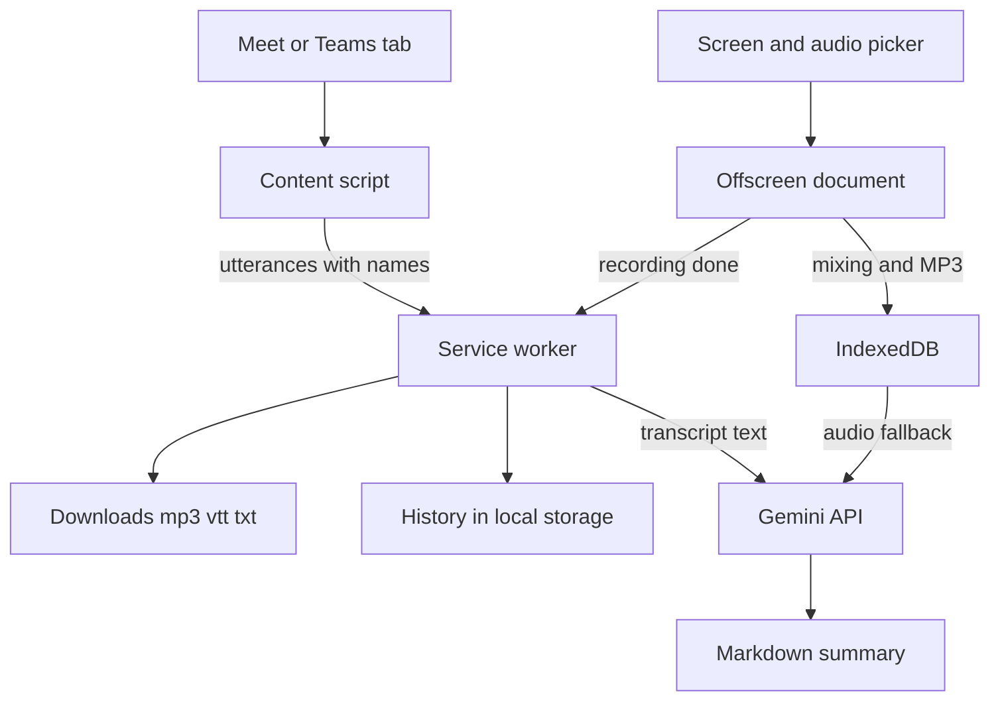

### Features in detail

#### MP3 recording

Audio goes from the browser to an offscreen document, the Manifest V3 piece that can keep media capture alive without a visible window.

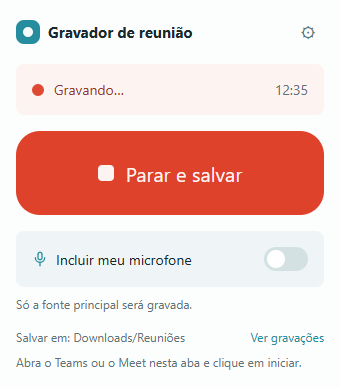 Extension popup while recording, with the timer and the stop button.

- The `getDisplayMedia` picker opens inside the offscreen document, not in the service worker. Video is discarded and only the audio track is used. If you forget to tick "share audio", the extension warns you.
- The microphone comes in through `getUserMedia` with echo cancellation and noise suppression. You choose the device and the gain (default 2). If the device disappears, it falls back to the default. If permission is denied, it records system audio only and says so.
- Mixing is a gain node fed by both sources. A mono ScriptProcessor reads the PCM and hands blocks of 1152 samples to lamejs.
- Sample rate is 44.1 kHz, mono, with a configurable bitrate (default 96 kbps). The encoder is single and continuous, so the final file is one whole MP3 with no seams.
- A watchdog checks every 5 seconds that blocks keep advancing. If audio stops flowing, the recording ends with an error instead of staying silent.

#### Official captions with speaker names

The extension uses the caption engine Meet and Teams already have, in the user's own browser.

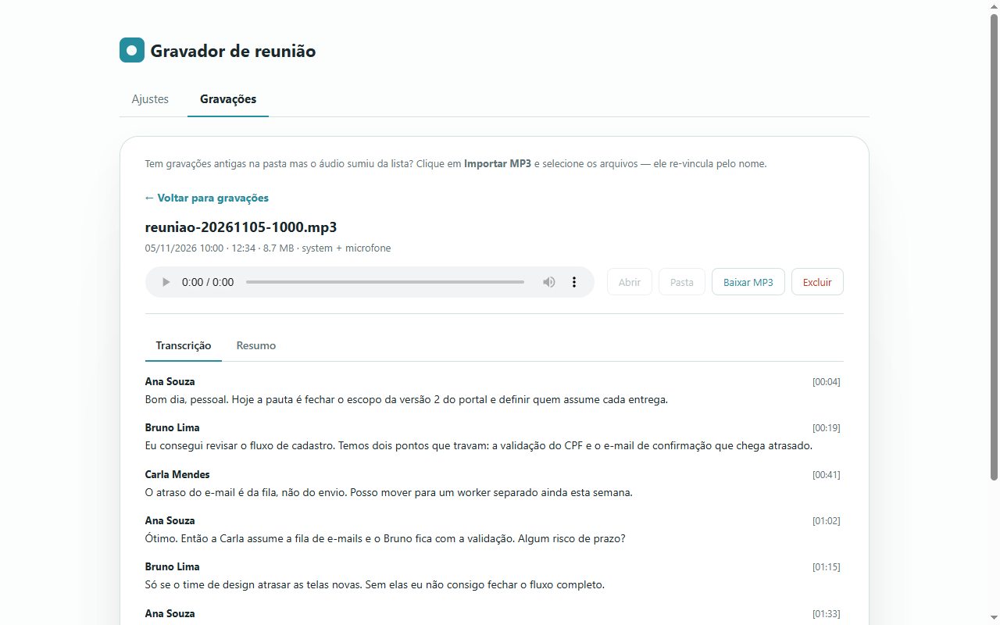 Transcript with the speaker name and timestamp of each turn, read from the meeting's own captions.

- A `MutationObserver` watches the DOM and schedules a short sweep on every change. Each caption block becomes its own record, keyed by the DOM node.
- On Meet, selectors cover the caption block, the speaker name (or the avatar `alt`) and the text. On Teams, text comes from `closed-caption-text` and the name from `author`, only inside the caption renderer, so chat stays out of the transcript.
- Meet erases old lines of a long utterance. `mergeCaptionText` therefore looks for the overlap between new and accumulated text and appends only what is missing.
- An utterance closes when its block leaves the screen or sits idle for 4 seconds. Whatever is said before Record goes to an in-memory buffer in the page and enters the transcript with negative time once recording starts.
- On Meet, the extension clicks the native caption button. On Teams, it opens More, Language and speech, and turns on "Show live captions", with the menu hidden by CSS. If you had already turned captions on, they stay visible and the extension only reads them.

#### Audio fallback

When the room has no captions, or company policy blocks them, the recording has no official transcript.

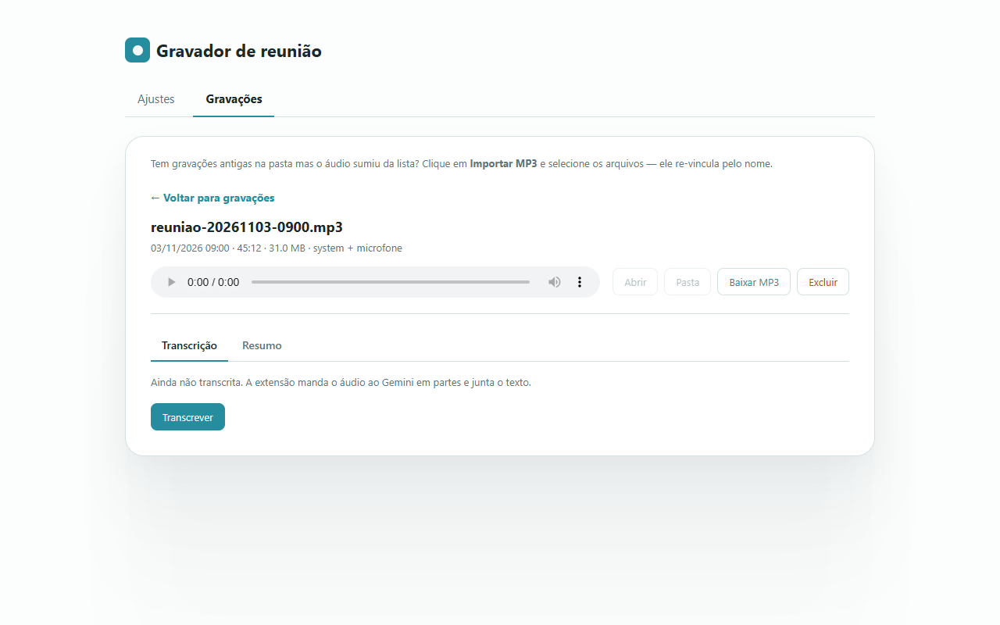 A recording without captions: the transcript comes from the audio, sent to Gemini in chunks.

- If you ask for a transcript or summary, the MP3 is sliced by byte offsets noted during encoding, without cutting the saved file.
- Each part is at most 10 minutes or about 11 MB, whichever comes first, and goes to Gemini as base64, one at a time, with a 3.5 s pause between calls.
- Transcripts are joined in order and the summary is built from that text.

#### Exports

- `.mp3`: downloaded on stop, into Downloads under the configured subfolder (default `Reuniões`), or with "Save as" if you prefer. The name follows a configurable date format with a live preview.
- `.vtt`: WebVTT blocks with `<v Name>` and times aligned to the MP3. It can download automatically or on demand.
- `.txt`: lines like `[mm:ss] Name: text`. Speech before Record shows as `[-02:10]`.
- `.md`: the summary, downloadable from the Recordings tab.

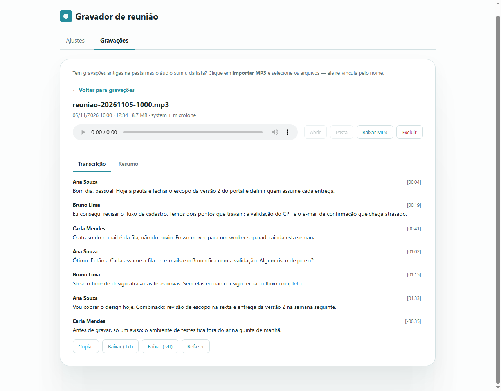 Recording detail with buttons to copy and download the transcript as .txt and .vtt.

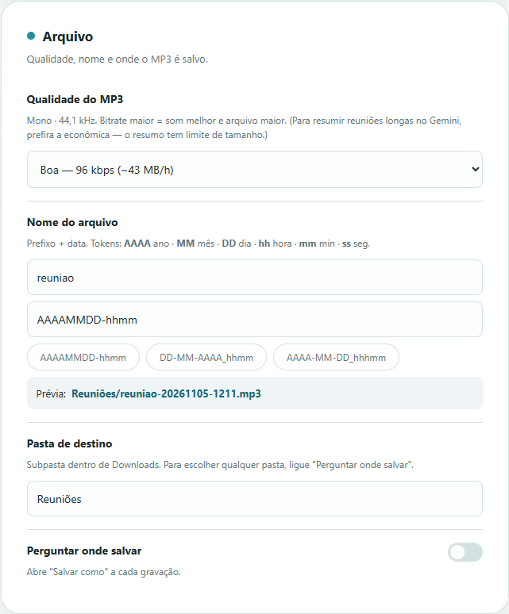 File settings: MP3 quality, filename format with a live preview, and destination folder.

#### Gemini summary

- The key is yours and lives in `chrome.storage.local`. The extension asks the API which models the key has and ranks them by preference (Flash first).
- If a model answers 429, 404 or 5xx, it moves to the next one and retries up to 3 rounds with growing waits.
- The prompt asks for an executive summary, participants, decisions, action items as a table, open points and next steps, attributed to the real names and without inventing anything. The language can follow the meeting or be fixed to Portuguese or English.
- Automatic summary on stop is off by default.

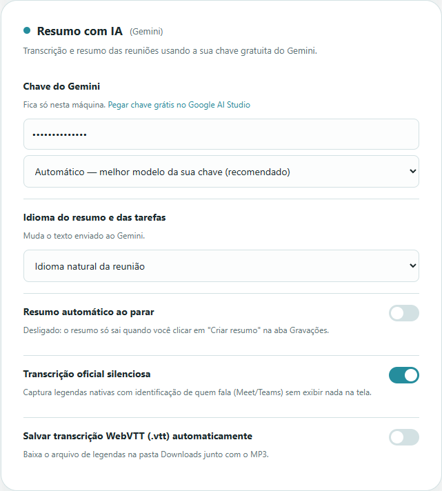 Summary settings: your own key, automatic model, language and automatic summary on stop.

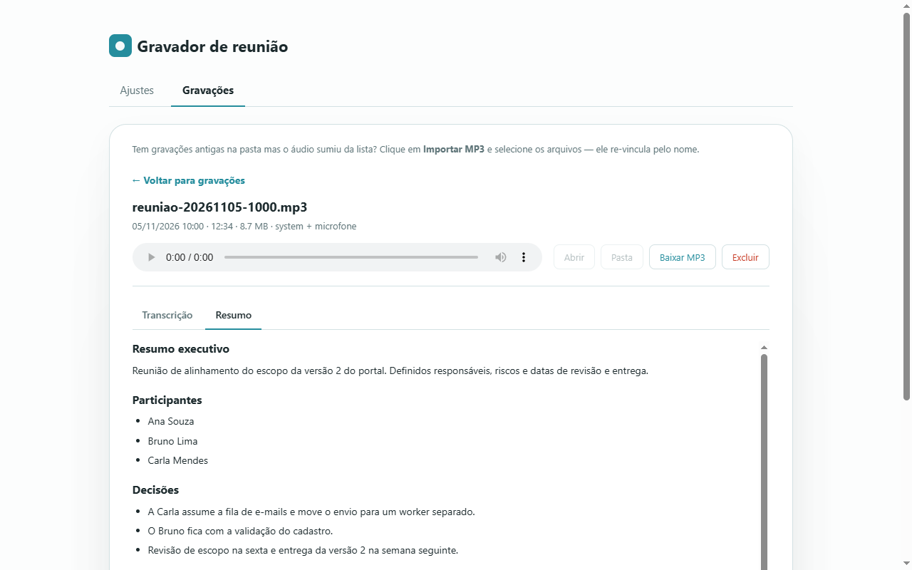 Generated summary with decisions, participants and action items.

#### History and interface

The Settings and Recordings page lists recordings with a player, transcript, summary, download and delete. The interface is in Portuguese and English, switchable at runtime. A floating pill, in Shadow DOM, reminds you to record when you join the call.

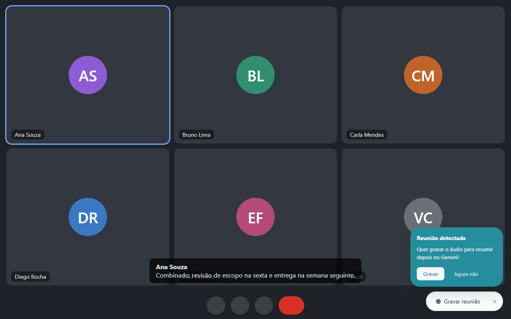 Floating pill that shows up when you join a call and reminds you to record.

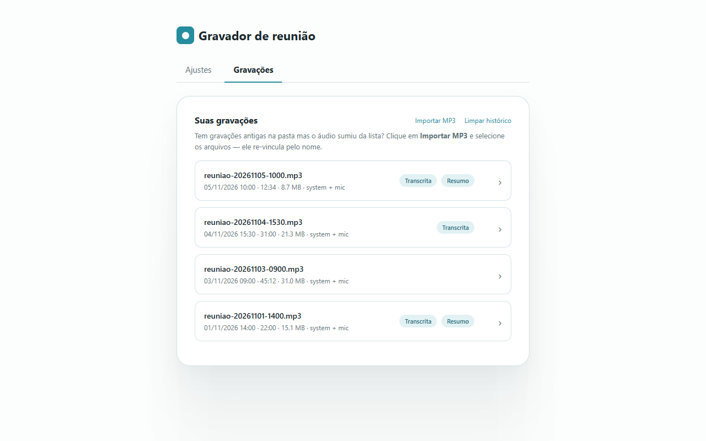 Recordings tab: list with duration, size and transcript and summary tags.

### Architecture

- `content.js`: pill, caption engine, buffer and delivery of utterances.
- `background.js`: service worker. State, `.txt` and `.vtt` assembly, downloads, notification, automatic summary.
- `offscreen.js`: capture, mixing and MP3 encoding.
- `gemini.js`: models, prompts, calls with rotation, slicing.
- `idb.js`, `format.js`, `md.js`, `i18n.js`: IndexedDB, file names, Markdown to HTML without a library, strings.
- `popup.js` and `options.js`: controls and history.

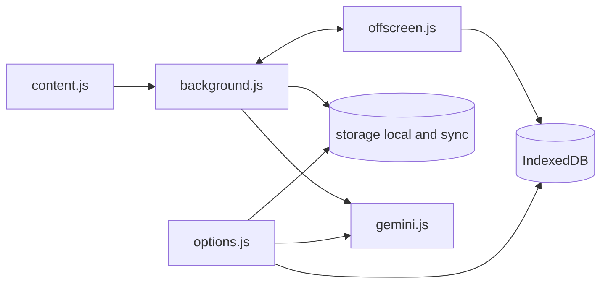

Where the data lives: the whole MP3 of each recording is in IndexedDB (the 12 most recent). Metadata, transcript, VTT and summary are in `chrome.storage.local` (up to 50 records). Settings are in `chrome.storage.sync`. The Gemini key is in `chrome.storage.local`. The state of a recording in progress is in `chrome.storage.session`.

### Engineering decisions

1. **Encode MP3 live.** The old path recorded webm, decoded everything to PCM and encoded at the end. Past roughly 10 minutes the renderer ran out of memory and Chrome killed the offscreen document without an error, so the recording vanished. Encoding block by block keeps memory almost flat.
2. **One file, with marked cuts.** The saved MP3 is never cut. Cut points are only byte offsets at frame boundaries, used by the fallback to slice the blob at transcription time.
3. **Read the official caption instead of listening to audio.** It gives the real speaker name and avoids sending heavy audio to Gemini. The summary starts from plain text.
4. **State persisted in `storage.session`.** The MV3 service worker sleeps and loses variables. The recording in progress and the accumulated utterances survive sleep, and long calls use a keep-alive.
5. **Automatic model selection.** Models get renamed and retired. Listing the ones the key has and rotating among them avoids pinning a name that may return 404.
6. **Give the last utterance time.** The final utterance arrives after Stop, so the service worker waits 1.5 s before closing the transcript.

### Privacy

- The MP3, the transcript and the history stay in the browser. There is no backend of its own.
- The only data that leaves the machine goes to the Gemini API, and only if you paste a key: the transcript text for the summary and, in the fallback, the audio in parts.
- Utterances captured before recording stay in the tab's memory only and vanish if it closes.
- Permissions and why: `offscreen` (capture and encoding), `downloads` and `downloads.open` (save and open files), `storage` and `unlimitedStorage` (settings, history and audio), `tabs` (reuse the recordings tab and talk to the meeting tab), `notifications` (alert on save). Access to the Meet and Teams sites for the content script, and to `generativelanguage.googleapis.com` for the summary. The microphone is requested through the browser, on a visible screen.

### Known limits

- Each audio part sent to Gemini is capped at about 14 MB in inline upload.
- The microphone needs a visible screen for the permission. Use headphones to avoid meeting echo.
- Without captions there is no speaker name on that path. The audio fallback only labels "Pessoa 1", "Pessoa 2" when it can tell the voices apart.
- Without asking where to save, Chrome only writes inside Downloads. For another folder, use "Ask where to save".
- The Meet and Teams DOM selectors depend on the current layout of both platforms.

### How to use

1. Install it from the [Chrome Web Store](https://chromewebstore.google.com/detail/gravador-de-reuni%C3%A3o-%E2%86%92-mp3/oblcnhlpjjipaodcifnignjfdbgmmkdg?hl=en) and pin the icon.
2. Join the meeting in the browser (Meet or Teams) and grant the microphone permission the first time.
3. Click **Record** on the page reminder or on the extension icon, and **Stop** at the end.
4. Open the recordings page to view, copy or download the transcript and the summary.

### Install from source

`chrome://extensions`, turn on **Developer mode**, click **Load unpacked** and select this folder.

Contact: <a href="https://joaocouto.alcetus.com">joaocouto.alcetus.com</a> · <a href="mailto:joaopecouto77@gmail.com">joaopecouto77@gmail.com</a>
