

<h1 align="center">Gravador de Reunião</h1>

Extensão Chrome (Manifest V3) que grava, transcreve e resume reuniões do Google Meet e do Microsoft Teams.

  <kbd> Manifest V3</kbd> <kbd> JavaScript</kbd> <kbd> Gemini API</kbd>

<kbd><b>Português</b></kbd> <a href="./README.en.md"><kbd>English</kbd></a>

  <a href="https://chromewebstore.google.com/detail/gravador-de-reuni%C3%A3o-%E2%86%92-mp3/oblcnhlpjjipaodcifnignjfdbgmmkdg?hl=pt-br"><kbd> Instalar pela Chrome Web Store</kbd></a>

<table>
<tr>
<td align="center" width="33%"><b>v1.1.0</b> na Chrome Web Store</td><td align="center" width="33%"><b>.mp3 .vtt .txt</b> formatos de exportação</td><td align="center" width="33%"><b>100% local</b> o áudio não sai da máquina</td>
</tr>
</table>

### Visão geral

O Gravador de Reunião é uma extensão do Chrome (Manifest V3) que grava o áudio do sistema e, se você quiser, o microfone, e entrega um MP3 leve codificado na própria máquina. Em paralelo, ela lê as legendas oficiais do Google Meet e do Microsoft Teams e monta uma transcrição com o nome de quem fala. No fim você tem `.mp3`, `.vtt` e `.txt`, mais um resumo opcional gerado pelo Gemini com a sua própria chave. Nenhum bot entra na sala e não existe servidor próprio: tudo fica no navegador. Versão atual: 1.1.0, publicada na Chrome Web Store.

### Como funciona

1. Você entra na reunião pelo navegador. O content script liga as legendas do Meet ou do Teams e as esconde com CSS, para elas não aparecerem na tela.
2. Ao clicar em Gravar (no balão da página ou no popup), o service worker cria um offscreen document, que abre o seletor de tela ou aba com compartilhamento de áudio.
3. O offscreen mistura o áudio capturado com o microfone (opcional) pela Web Audio API e codifica MP3 em tempo real com lamejs.
4. Enquanto isso, o content script envia cada fala fechada (quem falou, texto, início e fim) ao service worker.
5. Ao parar, o offscreen finaliza o MP3, guarda o arquivo no IndexedDB e avisa o service worker. O service worker monta o `.txt` e o `.vtt`, salva os metadados, baixa o MP3 e mostra uma notificação.
6. Se houver chave do Gemini, o resumo sai direto do texto da transcrição. Sem legendas, a extensão cai no fallback: transcreve o áudio por partes e resume o resultado.

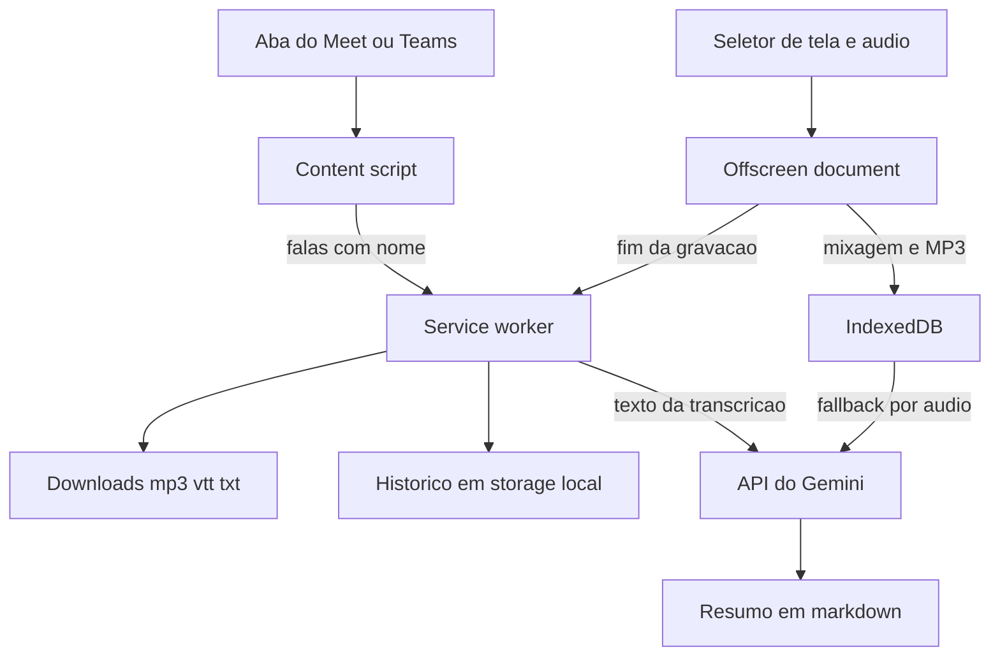

### Funcionalidades em detalhe

#### Gravação de áudio em MP3

O áudio vai do navegador para um offscreen document, a peça do Manifest V3 que consegue manter captura de mídia viva sem janela visível.

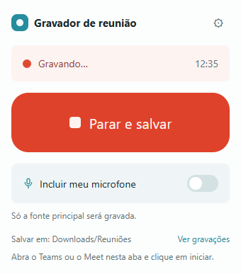 Popup da extensão durante a gravação, com o cronômetro e o botão de parar.

- O seletor de `getDisplayMedia` abre dentro do offscreen, não no service worker. O vídeo é descartado e só a faixa de áudio é usada. Se você esquecer de marcar "compartilhar áudio", a extensão avisa.
- O microfone entra pelo `getUserMedia` com cancelamento de eco e supressão de ruído. Você escolhe o aparelho e o ganho (padrão 2). Se o aparelho sumir, volta para o padrão. Se a permissão for negada, grava só o sistema e avisa.
- A mixagem é um nó de ganho alimentado pelas duas fontes. Um ScriptProcessor mono lê o PCM e entrega blocos de 1152 amostras ao lamejs.
- A taxa é de 44,1 kHz, mono, com bitrate configurável (padrão 96 kbps). O encoder é único e contínuo, então o arquivo final é um MP3 inteiro, sem emendas.
- Um watchdog confere a cada 5 segundos se os blocos continuam avançando. Se o áudio parar de fluir, a gravação termina com erro em vez de ficar muda.

#### Legendas oficiais com quem fala

A extensão usa o motor de legendas que o Meet e o Teams já têm, no navegador do próprio usuário.

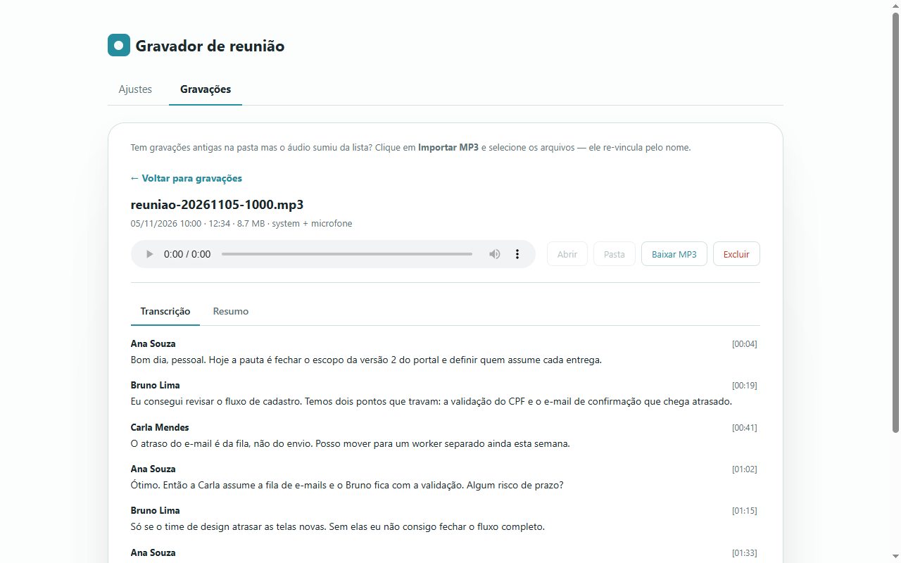 Transcrição com o nome de quem fala e o tempo de cada fala, lida das legendas da própria sala.

- Um `MutationObserver` observa o DOM e agenda uma varredura curta a cada mudança. Cada bloco de legenda vira um registro próprio, indexado pelo nó do DOM.
- No Meet, os seletores cobrem o bloco de legenda, o nome do falante (ou o `alt` do avatar) e o texto. No Teams, o texto vem de `closed-caption-text` e o nome de `author`, só dentro do renderizador de legendas, para o chat não entrar na transcrição.
- O Meet apaga as linhas antigas de uma fala longa. Por isso `mergeCaptionText` procura a sobreposição entre o texto novo e o acumulado e só acrescenta o que falta.
- Uma fala fecha quando o bloco sai da tela ou fica 4 segundos parado. O que é dito antes do Gravar vai para um buffer em memória na página e entra na transcrição com tempo negativo quando a gravação começa.
- No Meet, a extensão clica no botão nativo de legenda. No Teams, abre o menu Mais, Idioma e fala, e liga "Mostrar legendas ao vivo", com o menu escondido por CSS. Se você já tinha ligado as legendas, elas continuam visíveis e a extensão só lê.

#### Fallback por áudio

Quando a sala não tem legenda, ou a política da empresa a bloqueia, a gravação fica sem transcrição oficial.

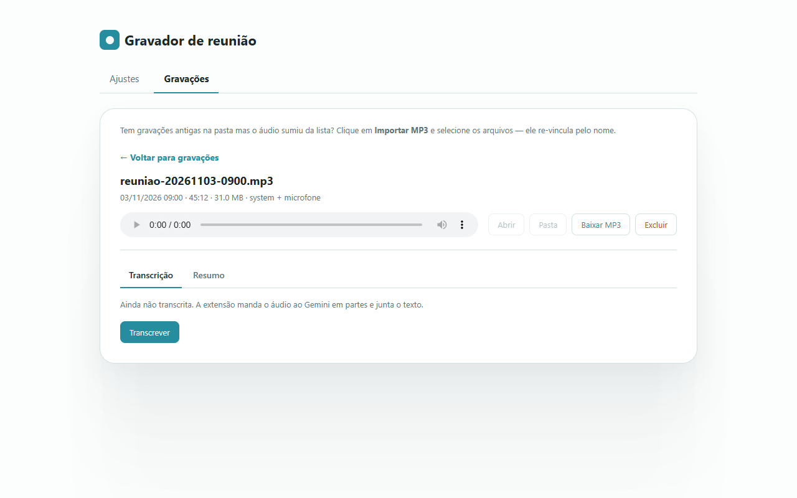 Gravação sem legenda: a transcrição sai do áudio, enviado ao Gemini em partes.

- Se você pedir transcrição ou resumo, o MP3 é fatiado por offsets de byte anotados durante a codificação, sem cortar o arquivo salvo.
- Cada parte tem no máximo 10 minutos ou cerca de 11 MB, o que vier primeiro, e vai ao Gemini em base64, uma de cada vez, com pausa de 3,5 s entre chamadas.
- As transcrições são juntadas em ordem e o resumo sai desse texto.

#### Exportações

- `.mp3`: baixado ao parar, em Downloads, na subpasta configurada (padrão `Reuniões`), ou com "Salvar como" se você preferir. O nome segue um formato de data configurável, com prévia ao vivo.
- `.vtt`: blocos WebVTT com `<v Nome>` e tempos alinhados ao MP3. Pode baixar automático ou sob demanda.
- `.txt`: linhas `[mm:ss] Nome: texto`. Falas anteriores ao Gravar aparecem como `[-02:10]`.
- `.md`: o resumo, baixável pela aba Gravações.

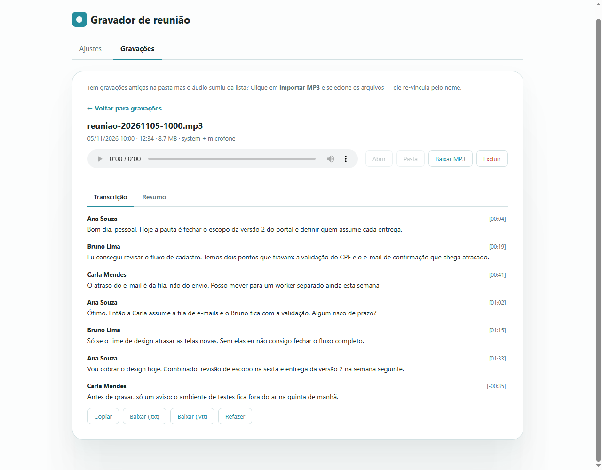 Detalhe da gravação com os botões para copiar e baixar a transcrição em .txt e .vtt.

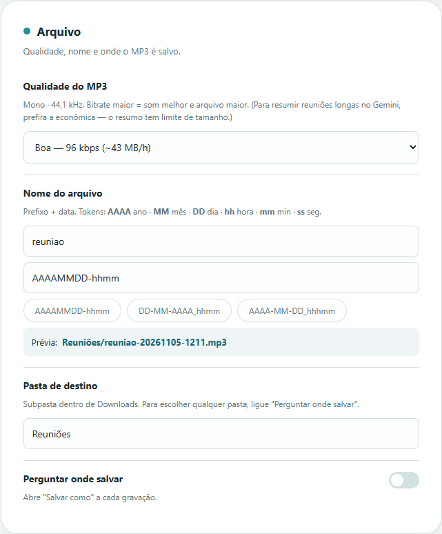 Ajustes do arquivo: qualidade do MP3, formato do nome com prévia ao vivo e pasta de destino.

#### Resumo com Gemini

- A chave é sua e fica em `chrome.storage.local`. A extensão pergunta à API quais modelos a chave possui e ordena por preferência (Flash primeiro).
- Se um modelo responder 429, 404 ou 5xx, passa para o próximo e repete até 3 rodadas, com espera crescente.
- O prompt pede resumo executivo, participantes, decisões, itens de ação em tabela, pontos em aberto e próximos passos, atribuídos aos nomes reais e sem inventar nada. O idioma pode seguir a reunião ou ficar fixo em português ou inglês.
- O resumo automático ao parar vem desligado por padrão.

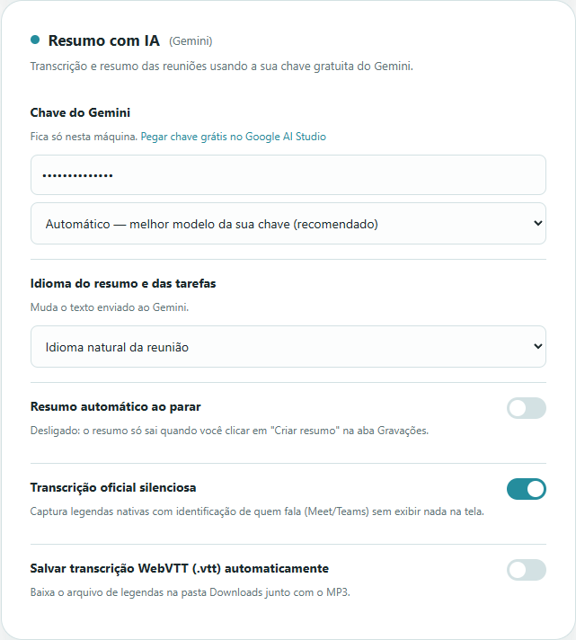 Ajustes do resumo: chave própria, modelo automático, idioma e resumo automático ao parar.

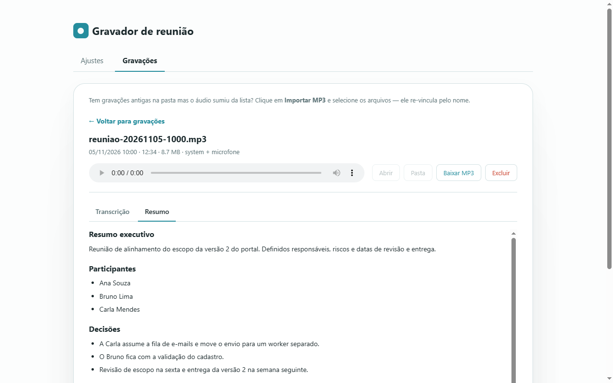 Resumo gerado com decisões, participantes e itens de ação.

#### Histórico e interface

A página de Ajustes e Gravações lista as gravações, com player, transcrição, resumo, download e exclusão. A interface tem português e inglês, com troca em tempo de execução. Um balão flutuante, em Shadow DOM, lembra de gravar ao entrar na call.

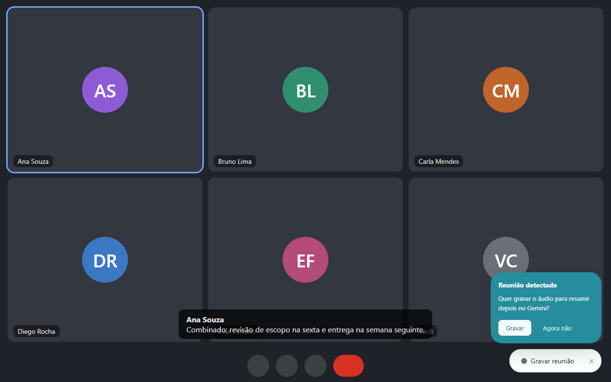 Balão flutuante que aparece ao entrar na call e lembra de gravar.

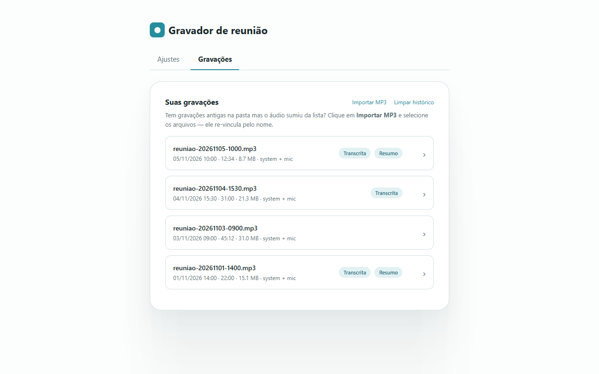 Aba Gravações: lista com duração, tamanho e marcas de transcrição e resumo.

### Arquitetura

- `content.js`: balão, motor de legendas, buffer e envio das falas.
- `background.js`: service worker. Estado, montagem de `.txt` e `.vtt`, downloads, notificação, resumo automático.
- `offscreen.js`: captura, mixagem e codificação MP3.
- `gemini.js`: modelos, prompts, chamadas com revezamento, fatiamento.
- `idb.js`, `format.js`, `md.js`, `i18n.js`: IndexedDB, nomes de arquivo, Markdown para HTML sem biblioteca, textos.
- `popup.js` e `options.js`: controles e histórico.

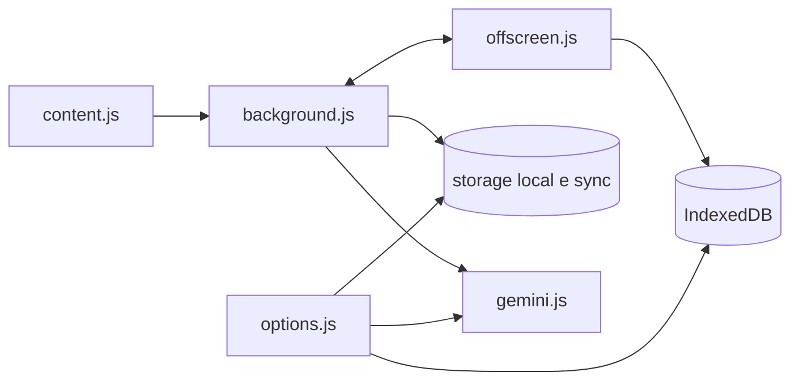

Onde ficam os dados: o MP3 inteiro de cada gravação fica no IndexedDB (as 12 mais recentes). Metadados, transcrição, VTT e resumo ficam em `chrome.storage.local` (até 50 registros). Os ajustes ficam em `chrome.storage.sync`. A chave do Gemini fica em `chrome.storage.local`. O estado da gravação em andamento fica em `chrome.storage.session`.

### Decisões de engenharia

1. **Codificar MP3 ao vivo.** O caminho antigo gravava webm, decodificava tudo em PCM e codificava no fim. A partir de uns 10 minutos o renderer estourava a memória e o Chrome encerrava o offscreen sem erro, e a gravação sumia. Codificar bloco a bloco mantém a memória quase constante.
2. **Um arquivo só, com cortes anotados.** O MP3 salvo nunca é cortado. Os pontos de corte são apenas offsets de byte em limites de frame, usados no fallback para fatiar o blob na hora de transcrever.
3. **Ler a legenda oficial em vez de ouvir o áudio.** Dá o nome real de quem fala e dispensa mandar áudio pesado ao Gemini. O resumo parte de texto puro.
4. **Estado persistido em `storage.session`.** O service worker do MV3 dorme e perde variáveis. A gravação em andamento e as falas acumuladas sobrevivem ao sono, e chamadas longas usam um keep-alive.
5. **Seleção automática de modelo.** Modelos mudam de nome e saem do ar. Listar os que a chave tem e revezar entre eles evita fixar um nome que pode dar 404.
6. **Dar tempo à última fala.** A fala final chega depois do Parar, então o service worker espera 1,5 s antes de fechar a transcrição.

### Privacidade

- O MP3, a transcrição e o histórico ficam no navegador. Não há backend próprio.
- Só sai da máquina o que vai à API do Gemini, e apenas se você colar uma chave: o texto da transcrição para o resumo e, no fallback, o áudio em partes.
- As falas capturadas antes de gravar ficam só na memória da aba e somem se ela fechar.
- Permissões e motivo: `offscreen` (captura e codificação), `downloads` e `downloads.open` (salvar e abrir arquivos), `storage` e `unlimitedStorage` (ajustes, histórico e áudios), `tabs` (reaproveitar a aba de gravações e falar com a aba da reunião), `notifications` (aviso ao salvar). Acesso aos sites do Meet e do Teams para o content script, e a `generativelanguage.googleapis.com` para o resumo. O microfone é pedido pelo navegador, numa tela visível.

### Limites conhecidos

- Cada parte de áudio enviada ao Gemini tem teto de cerca de 14 MB no envio inline.
- O microfone exige uma tela visível para a permissão. Use fones para evitar o eco da reunião.
- Sem legenda disponível não há nome de quem fala por esse caminho. O fallback por áudio só marca "Pessoa 1", "Pessoa 2" quando consegue distinguir as vozes.
- Sem perguntar onde salvar, o Chrome só grava dentro de Downloads. Para outra pasta, use "Perguntar onde salvar".
- Os seletores do DOM do Meet e do Teams dependem do layout atual das duas plataformas.

### Como usar

1. Instale pela [Chrome Web Store](https://chromewebstore.google.com/detail/gravador-de-reuni%C3%A3o-%E2%86%92-mp3/oblcnhlpjjipaodcifnignjfdbgmmkdg?hl=pt-br) e fixe o ícone na barra.
2. Entre na reunião pelo navegador (Meet ou Teams) e conceda a permissão do microfone na primeira vez.
3. Clique em **Gravar** no lembrete da página ou no ícone da extensão, e em **Parar** ao final.
4. Abra a página de gravações para ver, copiar ou baixar a transcrição e o resumo.

### Instalar o código-fonte

`chrome://extensions`, ligue o **Modo do desenvolvedor**, clique em **Carregar sem compactação** e selecione esta pasta.

Contato: <a href="https://joaocouto.alcetus.com">joaocouto.alcetus.com</a> · <a href="mailto:joaopecouto77@gmail.com">joaopecouto77@gmail.com</a>
