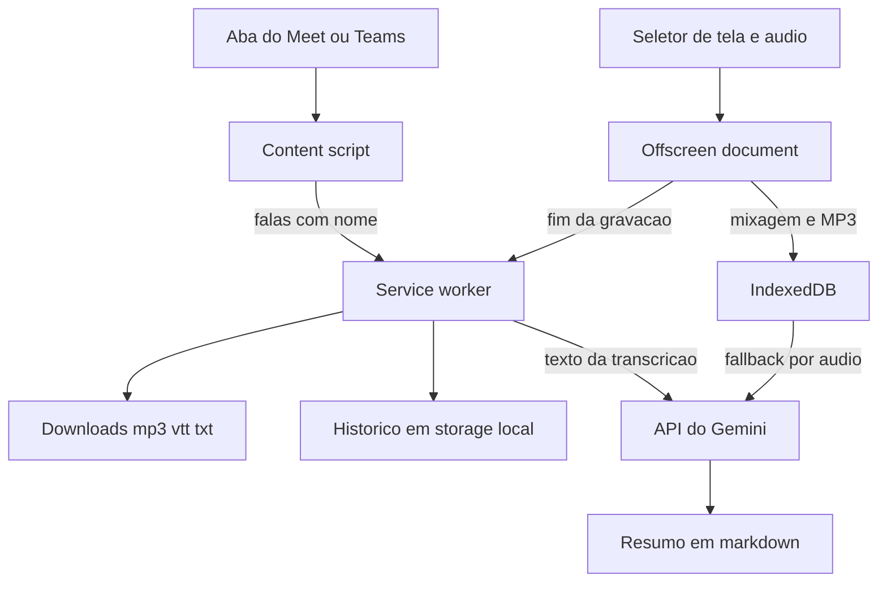
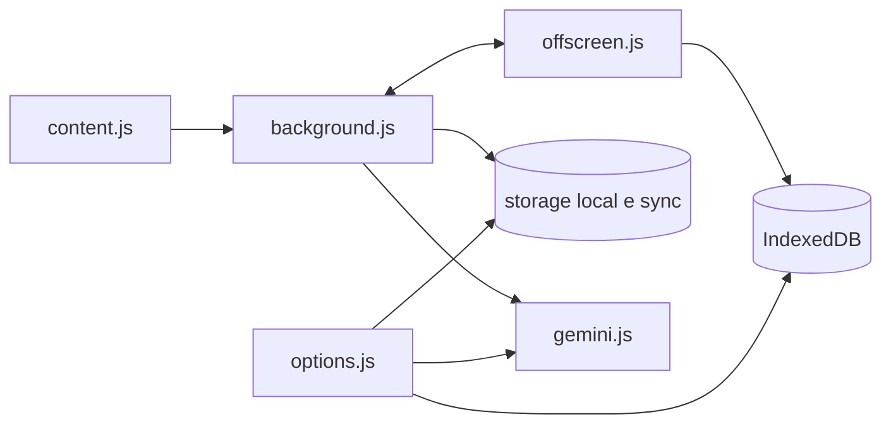
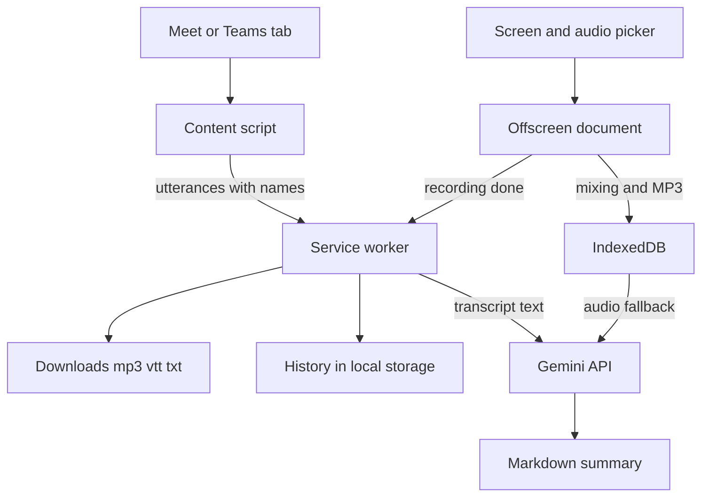
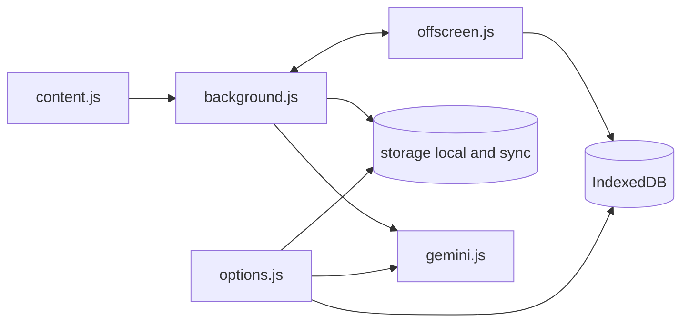

<h1 align="center">Gravador de Reunião</h1>

Extensão Chrome (Manifest V3) que grava, transcreve e resume reuniões do Google Meet e do Microsoft Teams. <i>Chrome extension (Manifest V3) that records, transcribes and summarizes Google Meet and Microsoft Teams meetings.</i>

  <kbd> Manifest V3</kbd> <kbd> JavaScript</kbd> <kbd> Gemini API</kbd>

<a href="#portugu%C3%AAs"><b>Português</b></a> &nbsp;|&nbsp; <a href="#english"><b>English</b></a>

  <a href="https://chromewebstore.google.com/detail/gravador-de-reuni%C3%A3o-%E2%86%92-mp3/oblcnhlpjjipaodcifnignjfdbgmmkdg?hl=pt-br"><kbd> Instalar pela Chrome Web Store</kbd></a>
  <a href="https://chromewebstore.google.com/detail/gravador-de-reuni%C3%A3o-%E2%86%92-mp3/oblcnhlpjjipaodcifnignjfdbgmmkdg?hl=en"><kbd> Install from the Chrome Web Store</kbd></a>

## Português

<table>
<tr>
<td align="center" width="33%"><b>v1.1.0</b> na Chrome Web Store</td><td align="center" width="33%"><b>.mp3 .vtt .txt</b> formatos de exportação</td><td align="center" width="33%"><b>100% local</b> o áudio não sai da máquina</td>
</tr>
</table>

### Visão geral

O Gravador de Reunião é uma extensão do Chrome (Manifest V3) que grava o áudio do sistema e, se você quiser, o microfone, e entrega um MP3 leve codificado na própria máquina. Em paralelo, ela lê as legendas oficiais do Google Meet e do Microsoft Teams e monta uma transcrição com o nome de quem fala. No fim você tem `.mp3`, `.vtt` e `.txt`, mais um resumo opcional gerado pelo Gemini com a sua própria chave. Nenhum bot entra na sala e não existe servidor próprio: tudo fica no navegador. Versão atual: 1.1.0, publicada na Chrome Web Store.

### Como funciona

1. Você entra na reunião pelo navegador. O content script liga as legendas do Meet ou do Teams e as esconde com CSS, para elas não aparecerem na tela.
2. Ao clicar em Gravar (no balão da página ou no popup), o service worker cria um offscreen document, que abre o seletor de tela ou aba com compartilhamento de áudio.
3. O offscreen mistura o áudio capturado com o microfone (opcional) pela Web Audio API e codifica MP3 em tempo real com lamejs.
4. Enquanto isso, o content script envia cada fala fechada (quem falou, texto, início e fim) ao service worker.
5. Ao parar, o offscreen finaliza o MP3, guarda o arquivo no IndexedDB e avisa o service worker. O service worker monta o `.txt` e o `.vtt`, salva os metadados, baixa o MP3 e mostra uma notificação.
6. Se houver chave do Gemini, o resumo sai direto do texto da transcrição. Sem legendas, a extensão cai no fallback: transcreve o áudio por partes e resume o resultado.

### Funcionalidades em detalhe

#### Gravação de áudio em MP3

O áudio vai do navegador para um offscreen document, a peça do Manifest V3 que consegue manter captura de mídia viva sem janela visível.

- O seletor de `getDisplayMedia` abre dentro do offscreen, não no service worker. O vídeo é descartado e só a faixa de áudio é usada. Se você esquecer de marcar "compartilhar áudio", a extensão avisa.
- O microfone entra pelo `getUserMedia` com cancelamento de eco e supressão de ruído. Você escolhe o aparelho e o ganho (padrão 2). Se o aparelho sumir, volta para o padrão. Se a permissão for negada, grava só o sistema e avisa.
- A mixagem é um nó de ganho alimentado pelas duas fontes. Um ScriptProcessor mono lê o PCM e entrega blocos de 1152 amostras ao lamejs.
- A taxa é de 44,1 kHz, mono, com bitrate configurável (padrão 96 kbps). O encoder é único e contínuo, então o arquivo final é um MP3 inteiro, sem emendas.
- Um watchdog confere a cada 5 segundos se os blocos continuam avançando. Se o áudio parar de fluir, a gravação termina com erro em vez de ficar muda.

#### Legendas oficiais com quem fala

A extensão usa o motor de legendas que o Meet e o Teams já têm, no navegador do próprio usuário.

- Um `MutationObserver` observa o DOM e agenda uma varredura curta a cada mudança. Cada bloco de legenda vira um registro próprio, indexado pelo nó do DOM.
- No Meet, os seletores cobrem o bloco de legenda, o nome do falante (ou o `alt` do avatar) e o texto. No Teams, o texto vem de `closed-caption-text` e o nome de `author`, só dentro do renderizador de legendas, para o chat não entrar na transcrição.
- O Meet apaga as linhas antigas de uma fala longa. Por isso `mergeCaptionText` procura a sobreposição entre o texto novo e o acumulado e só acrescenta o que falta.
- Uma fala fecha quando o bloco sai da tela ou fica 4 segundos parado. O que é dito antes do Gravar vai para um buffer em memória na página e entra na transcrição com tempo negativo quando a gravação começa.
- No Meet, a extensão clica no botão nativo de legenda. No Teams, abre o menu Mais, Idioma e fala, e liga "Mostrar legendas ao vivo", com o menu escondido por CSS. Se você já tinha ligado as legendas, elas continuam visíveis e a extensão só lê.

#### Fallback por áudio

Quando a sala não tem legenda, ou a política da empresa a bloqueia, a gravação fica sem transcrição oficial.

- Se você pedir transcrição ou resumo, o MP3 é fatiado por offsets de byte anotados durante a codificação, sem cortar o arquivo salvo.
- Cada parte tem no máximo 10 minutos ou cerca de 11 MB, o que vier primeiro, e vai ao Gemini em base64, uma de cada vez, com pausa de 3,5 s entre chamadas.
- As transcrições são juntadas em ordem e o resumo sai desse texto.

#### Exportações

- `.mp3`: baixado ao parar, em Downloads, na subpasta configurada (padrão `Reuniões`), ou com "Salvar como" se você preferir. O nome segue um formato de data configurável, com prévia ao vivo.
- `.vtt`: blocos WebVTT com `<v Nome>` e tempos alinhados ao MP3. Pode baixar automático ou sob demanda.
- `.txt`: linhas `[mm:ss] Nome: texto`. Falas anteriores ao Gravar aparecem como `[-02:10]`.
- `.md`: o resumo, baixável pela aba Gravações.

#### Resumo com Gemini

- A chave é sua e fica em `chrome.storage.local`. A extensão pergunta à API quais modelos a chave possui e ordena por preferência (Flash primeiro).
- Se um modelo responder 429, 404 ou 5xx, passa para o próximo e repete até 3 rodadas, com espera crescente.
- O prompt pede resumo executivo, participantes, decisões, itens de ação em tabela, pontos em aberto e próximos passos, atribuídos aos nomes reais e sem inventar nada. O idioma pode seguir a reunião ou ficar fixo em português ou inglês.
- O resumo automático ao parar vem desligado por padrão.

#### Histórico e interface

A página de Ajustes e Gravações lista as gravações, com player, transcrição, resumo, download e exclusão. A interface tem português e inglês, com troca em tempo de execução. Um balão flutuante, em Shadow DOM, lembra de gravar ao entrar na call.

### Arquitetura

- `content.js`: balão, motor de legendas, buffer e envio das falas.
- `background.js`: service worker. Estado, montagem de `.txt` e `.vtt`, downloads, notificação, resumo automático.
- `offscreen.js`: captura, mixagem e codificação MP3.
- `gemini.js`: modelos, prompts, chamadas com revezamento, fatiamento.
- `idb.js`, `format.js`, `md.js`, `i18n.js`: IndexedDB, nomes de arquivo, Markdown para HTML sem biblioteca, textos.
- `popup.js` e `options.js`: controles e histórico.

Onde ficam os dados: o MP3 inteiro de cada gravação fica no IndexedDB (as 12 mais recentes). Metadados, transcrição, VTT e resumo ficam em `chrome.storage.local` (até 50 registros). Os ajustes ficam em `chrome.storage.sync`. A chave do Gemini fica em `chrome.storage.local`. O estado da gravação em andamento fica em `chrome.storage.session`.

### Decisões de engenharia

1. **Codificar MP3 ao vivo.** O caminho antigo gravava webm, decodificava tudo em PCM e codificava no fim. A partir de uns 10 minutos o renderer estourava a memória e o Chrome encerrava o offscreen sem erro, e a gravação sumia. Codificar bloco a bloco mantém a memória quase constante.
2. **Um arquivo só, com cortes anotados.** O MP3 salvo nunca é cortado. Os pontos de corte são apenas offsets de byte em limites de frame, usados no fallback para fatiar o blob na hora de transcrever.
3. **Ler a legenda oficial em vez de ouvir o áudio.** Dá o nome real de quem fala e dispensa mandar áudio pesado ao Gemini. O resumo parte de texto puro.
4. **Estado persistido em `storage.session`.** O service worker do MV3 dorme e perde variáveis. A gravação em andamento e as falas acumuladas sobrevivem ao sono, e chamadas longas usam um keep-alive.
5. **Seleção automática de modelo.** Modelos mudam de nome e saem do ar. Listar os que a chave tem e revezar entre eles evita fixar um nome que pode dar 404.
6. **Dar tempo à última fala.** A fala final chega depois do Parar, então o service worker espera 1,5 s antes de fechar a transcrição.

### Privacidade

- O MP3, a transcrição e o histórico ficam no navegador. Não há backend próprio.
- Só sai da máquina o que vai à API do Gemini, e apenas se você colar uma chave: o texto da transcrição para o resumo e, no fallback, o áudio em partes.
- As falas capturadas antes de gravar ficam só na memória da aba e somem se ela fechar.
- Permissões e motivo: `offscreen` (captura e codificação), `downloads` e `downloads.open` (salvar e abrir arquivos), `storage` e `unlimitedStorage` (ajustes, histórico e áudios), `tabs` (reaproveitar a aba de gravações e falar com a aba da reunião), `notifications` (aviso ao salvar). Acesso aos sites do Meet e do Teams para o content script, e a `generativelanguage.googleapis.com` para o resumo. O microfone é pedido pelo navegador, numa tela visível.

### Limites conhecidos

- Cada parte de áudio enviada ao Gemini tem teto de cerca de 14 MB no envio inline.
- O microfone exige uma tela visível para a permissão. Use fones para evitar o eco da reunião.
- Sem legenda disponível não há nome de quem fala por esse caminho. O fallback por áudio só marca "Pessoa 1", "Pessoa 2" quando consegue distinguir as vozes.
- Sem perguntar onde salvar, o Chrome só grava dentro de Downloads. Para outra pasta, use "Perguntar onde salvar".
- Os seletores do DOM do Meet e do Teams dependem do layout atual das duas plataformas.

### Como usar

1. Instale pela [Chrome Web Store](https://chromewebstore.google.com/detail/gravador-de-reuni%C3%A3o-%E2%86%92-mp3/oblcnhlpjjipaodcifnignjfdbgmmkdg?hl=pt-br) e fixe o ícone na barra.
2. Entre na reunião pelo navegador (Meet ou Teams) e conceda a permissão do microfone na primeira vez.
3. Clique em **Gravar** no lembrete da página ou no ícone da extensão, e em **Parar** ao final.
4. Abra a página de gravações para ver, copiar ou baixar a transcrição e o resumo.

### Instalar o código-fonte

`chrome://extensions`, ligue o **Modo do desenvolvedor**, clique em **Carregar sem compactação** e selecione esta pasta.

## English

<table>
<tr>
<td align="center" width="33%"><b>v1.1.0</b> on the Chrome Web Store</td><td align="center" width="33%"><b>.mp3 .vtt .txt</b> export formats</td><td align="center" width="33%"><b>100% local</b> audio never leaves the machine</td>
</tr>
</table>

### Overview

Meeting Recorder is a Chrome extension (Manifest V3) that records system audio and, optionally, your microphone, and delivers a lightweight MP3 encoded on your own machine. In parallel it reads the official captions from Google Meet and Microsoft Teams and builds a transcript with the speaker's name. In the end you get `.mp3`, `.vtt` and `.txt` files, plus an optional summary from Gemini using your own key. No bot joins the room and there is no server of its own: everything stays in the browser. Current version: 1.1.0, published on the Chrome Web Store.

### How it works

1. You join the meeting in the browser. The content script turns on the Meet or Teams captions and hides them with CSS, so they never show on screen.
2. When you click Record (in the page pill or the popup), the service worker creates an offscreen document, which opens the screen or tab picker with audio sharing.
3. The offscreen document mixes the captured audio with the microphone (optional) through the Web Audio API and encodes MP3 in real time with lamejs.
4. Meanwhile the content script sends each closed utterance (speaker, text, start and end) to the service worker.
5. On stop, the offscreen document finishes the MP3, stores the file in IndexedDB and notifies the service worker. The service worker builds the `.txt` and `.vtt`, saves the metadata, downloads the MP3 and shows a notification.
6. With a Gemini key set, the summary comes straight from the transcript text. Without captions, the extension falls back to transcribing the audio in parts and summarizing the result.

### Features in detail

#### MP3 recording

Audio goes from the browser to an offscreen document, the Manifest V3 piece that can keep media capture alive without a visible window.

- The `getDisplayMedia` picker opens inside the offscreen document, not in the service worker. Video is discarded and only the audio track is used. If you forget to tick "share audio", the extension warns you.
- The microphone comes in through `getUserMedia` with echo cancellation and noise suppression. You choose the device and the gain (default 2). If the device disappears, it falls back to the default. If permission is denied, it records system audio only and says so.
- Mixing is a gain node fed by both sources. A mono ScriptProcessor reads the PCM and hands blocks of 1152 samples to lamejs.
- Sample rate is 44.1 kHz, mono, with a configurable bitrate (default 96 kbps). The encoder is single and continuous, so the final file is one whole MP3 with no seams.
- A watchdog checks every 5 seconds that blocks keep advancing. If audio stops flowing, the recording ends with an error instead of staying silent.

#### Official captions with speaker names

The extension uses the caption engine Meet and Teams already have, in the user's own browser.

- A `MutationObserver` watches the DOM and schedules a short sweep on every change. Each caption block becomes its own record, keyed by the DOM node.
- On Meet, selectors cover the caption block, the speaker name (or the avatar `alt`) and the text. On Teams, text comes from `closed-caption-text` and the name from `author`, only inside the caption renderer, so chat stays out of the transcript.
- Meet erases old lines of a long utterance. `mergeCaptionText` therefore looks for the overlap between new and accumulated text and appends only what is missing.
- An utterance closes when its block leaves the screen or sits idle for 4 seconds. Whatever is said before Record goes to an in-memory buffer in the page and enters the transcript with negative time once recording starts.
- On Meet, the extension clicks the native caption button. On Teams, it opens More, Language and speech, and turns on "Show live captions", with the menu hidden by CSS. If you had already turned captions on, they stay visible and the extension only reads them.

#### Audio fallback

When the room has no captions, or company policy blocks them, the recording has no official transcript.

- If you ask for a transcript or summary, the MP3 is sliced by byte offsets noted during encoding, without cutting the saved file.
- Each part is at most 10 minutes or about 11 MB, whichever comes first, and goes to Gemini as base64, one at a time, with a 3.5 s pause between calls.
- Transcripts are joined in order and the summary is built from that text.

#### Exports

- `.mp3`: downloaded on stop, into Downloads under the configured subfolder (default `Reuniões`), or with "Save as" if you prefer. The name follows a configurable date format with a live preview.
- `.vtt`: WebVTT blocks with `<v Name>` and times aligned to the MP3. It can download automatically or on demand.
- `.txt`: lines like `[mm:ss] Name: text`. Speech before Record shows as `[-02:10]`.
- `.md`: the summary, downloadable from the Recordings tab.

#### Gemini summary

- The key is yours and lives in `chrome.storage.local`. The extension asks the API which models the key has and ranks them by preference (Flash first).
- If a model answers 429, 404 or 5xx, it moves to the next one and retries up to 3 rounds with growing waits.
- The prompt asks for an executive summary, participants, decisions, action items as a table, open points and next steps, attributed to the real names and without inventing anything. The language can follow the meeting or be fixed to Portuguese or English.
- Automatic summary on stop is off by default.

#### History and interface

The Settings and Recordings page lists recordings with a player, transcript, summary, download and delete. The interface is in Portuguese and English, switchable at runtime. A floating pill, in Shadow DOM, reminds you to record when you join the call.

### Architecture

- `content.js`: pill, caption engine, buffer and delivery of utterances.
- `background.js`: service worker. State, `.txt` and `.vtt` assembly, downloads, notification, automatic summary.
- `offscreen.js`: capture, mixing and MP3 encoding.
- `gemini.js`: models, prompts, calls with rotation, slicing.
- `idb.js`, `format.js`, `md.js`, `i18n.js`: IndexedDB, file names, Markdown to HTML without a library, strings.
- `popup.js` and `options.js`: controls and history.

Where the data lives: the whole MP3 of each recording is in IndexedDB (the 12 most recent). Metadata, transcript, VTT and summary are in `chrome.storage.local` (up to 50 records). Settings are in `chrome.storage.sync`. The Gemini key is in `chrome.storage.local`. The state of a recording in progress is in `chrome.storage.session`.

### Engineering decisions

1. **Encode MP3 live.** The old path recorded webm, decoded everything to PCM and encoded at the end. Past roughly 10 minutes the renderer ran out of memory and Chrome killed the offscreen document without an error, so the recording vanished. Encoding block by block keeps memory almost flat.
2. **One file, with marked cuts.** The saved MP3 is never cut. Cut points are only byte offsets at frame boundaries, used by the fallback to slice the blob at transcription time.
3. **Read the official caption instead of listening to audio.** It gives the real speaker name and avoids sending heavy audio to Gemini. The summary starts from plain text.
4. **State persisted in `storage.session`.** The MV3 service worker sleeps and loses variables. The recording in progress and the accumulated utterances survive sleep, and long calls use a keep-alive.
5. **Automatic model selection.** Models get renamed and retired. Listing the ones the key has and rotating among them avoids pinning a name that may return 404.
6. **Give the last utterance time.** The final utterance arrives after Stop, so the service worker waits 1.5 s before closing the transcript.

### Privacy

- The MP3, the transcript and the history stay in the browser. There is no backend of its own.
- The only data that leaves the machine goes to the Gemini API, and only if you paste a key: the transcript text for the summary and, in the fallback, the audio in parts.
- Utterances captured before recording stay in the tab's memory only and vanish if it closes.
- Permissions and why: `offscreen` (capture and encoding), `downloads` and `downloads.open` (save and open files), `storage` and `unlimitedStorage` (settings, history and audio), `tabs` (reuse the recordings tab and talk to the meeting tab), `notifications` (alert on save). Access to the Meet and Teams sites for the content script, and to `generativelanguage.googleapis.com` for the summary. The microphone is requested through the browser, on a visible screen.

### Known limits

- Each audio part sent to Gemini is capped at about 14 MB in inline upload.
- The microphone needs a visible screen for the permission. Use headphones to avoid meeting echo.
- Without captions there is no speaker name on that path. The audio fallback only labels "Pessoa 1", "Pessoa 2" when it can tell the voices apart.
- Without asking where to save, Chrome only writes inside Downloads. For another folder, use "Ask where to save".
- The Meet and Teams DOM selectors depend on the current layout of both platforms.

### How to use

1. Install it from the [Chrome Web Store](https://chromewebstore.google.com/detail/gravador-de-reuni%C3%A3o-%E2%86%92-mp3/oblcnhlpjjipaodcifnignjfdbgmmkdg?hl=en) and pin the icon.
2. Join the meeting in the browser (Meet or Teams) and grant the microphone permission the first time.
3. Click **Record** on the page reminder or on the extension icon, and **Stop** at the end.
4. Open the recordings page to view, copy or download the transcript and the summary.

### Install from source

`chrome://extensions`, turn on **Developer mode**, click **Load unpacked** and select this folder.

Contato · Contact: <a href="https://joaocouto.alcetus.com">joaocouto.alcetus.com</a> · <a href="mailto:joaopecouto77@gmail.com">joaopecouto77@gmail.com</a>
